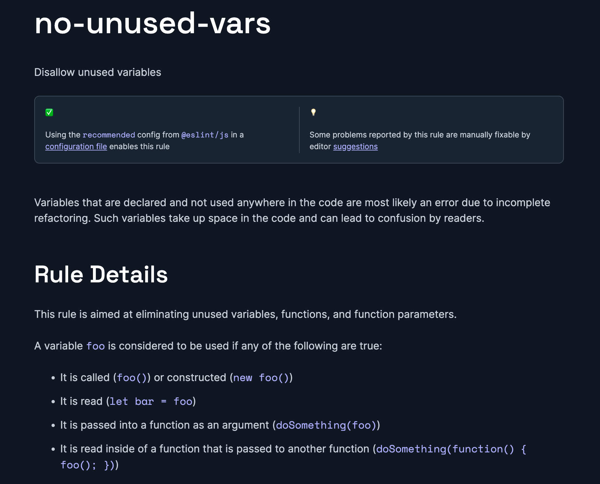

## Vite

- Backward *compatible*
- Uglification
  - Shortening **variable names**
- Minification
- Removing `dead code`

## Sample code block

```js
console.log("Hello")
```


## Package.json
1. Dependencies
2.  DevDependencies


## Eslint

